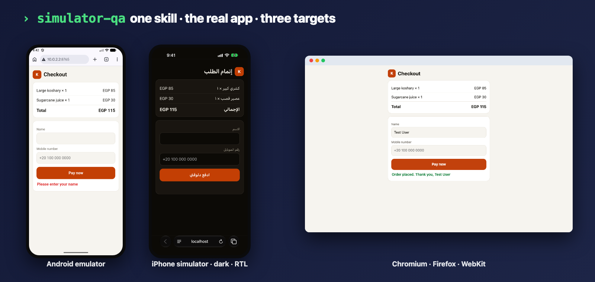

# simulator-qa

A skill that lets Claude Code test your feature the way a person would: in the
real running app, on an **Android emulator or device**, an **iOS simulator**,
or a **browser** — tapping, typing, opening links, taking screenshots and
actually looking at them, then telling you what works and what does not, with
the evidence.

It works with any stack: native Android, native iOS, Flutter, React Native,
Expo, or a website. It has no runtime of its own — it drives the tools you
already have (`adb`, `xcrun simctl`, Playwright) through small shell scripts
you can read in a few minutes.



*Real screenshots taken by the skill while testing a demo checkout page.*

```
> test the new checkout flow on the emulator, then in dark mode and in Arabic

> does the signup page work in Firefox and on an iPhone-sized screen?

> the deep link myapp://order/42 should open the order screen — verify it on the simulator

> here is the ticket and the design export — does the checkout screen match them?
```

## What Claude does with it

- **Drives the real thing.** OS-level taps, long presses, swipes, typing,
  hardware keys; deep links and intents fired the way another app would.
- **Looks.** Every step ends in a screenshot that Claude opens. A step does not
  count as verified until it has.
- **Reads the screen as text too.** One line per element with the point to tap,
  for exact targeting and for checking labels and accessibility.
- **Reads the logs.** App logs on devices; console errors, uncaught exceptions
  and failed requests in browsers.
- **Second passes.** Dark mode, another language, right-to-left, another
  screen size, another browser engine.
- **Checks it against the spec or the design.** Give it the requirements, the
  ticket or a design image in the session and it tests against them: missing
  elements, wrong wording, wrong order, an obviously wrong colour — reported as
  expected, actual and evidence, without assuming which side is out of date.
  It compares what a person would notice, not pixels.
- **Reports.** A verdict, a scenario table, bugs with repro steps and the
  screenshot, what could not be covered, and what was left on the device.
- **Stays careful.** Test data only, nothing that sends, pays or posts without
  asking, dev builds preferred, settings put back afterwards.

For **Flutter** there is an optional add-on that evaluates Dart inside the
running debug app: read the state a screen was built from, or seed a state that
is slow to reach by hand, and hot-reload after a fix.

## Install

**As a plugin** (Claude Code):

```
/plugin marketplace add MosasaUnited/simulator-qa
/plugin install simulator-qa@simulator-qa
```

**As a plain skill** — copy one folder:

```bash
git clone https://github.com/MosasaUnited/simulator-qa
cp -r simulator-qa/skills/simulator-qa ~/.claude/skills/        # every project
cp -r simulator-qa/skills/simulator-qa .claude/skills/          # or just this one
```

**Other agents** that support the open [Agent Skills](https://agentskills.io) format:

```bash
npx skills add MosasaUnited/simulator-qa
```

Then ask for what you want tested. Claude checks what is installed
(`devices.sh`) and tells you what is missing for the target you asked for.

## What you need

| To test on | You need | Host OS |
|---|---|---|
| Android emulator or device | Android Studio (for `adb`); an emulator, or a phone with USB debugging | macOS, Linux, Windows (Git Bash / WSL) |
| iOS simulator | Xcode; for taps, [AXe](https://github.com/cameroncooke/AXe) (`brew install cameroncooke/axe/axe`) or idb | macOS only |
| Browsers | Node.js 22+; Playwright and its engines, installed once by `setup-web.sh` into `~/.cache/simulator-qa` | macOS, Linux, Windows (Git Bash / WSL) |
| Flutter add-on | Flutter SDK, Node.js 22+ | as the device target |

Nothing is installed without being asked for, and nothing is added to your
project.

### Browsers, precisely

| Engine | Stands for |
|---|---|
| Chromium (or your installed Chrome / Edge) | Chrome, Edge, Brave, Android Chrome |
| Firefox | Firefox |
| WebKit | Safari and every iOS browser — the engine, not Safari's own UI |

Phone and tablet presets ("iPhone 15", "Pixel 7", "iPad Mini") emulate the
screen, touch and user agent in any engine. For the real mobile browser —
on-screen keyboard, safe areas, real Safari — the same commands drive Chrome on
the Android emulator and Safari on the iOS simulator.

## Optional project settings

A `.simulator-qa.env` at the project root saves Claude working things out each
session:

```
QA_APP=com.example.shop.dev
QA_FLUTTER_ARGS=--flavor dev
QA_FLUTTER_STATE=CartScreen.controller
```

## What was actually tested

Tested on one machine (macOS, Apple silicon) in November 2026. Everything else
is designed to work but has not been run by the author — reports welcome.

| Target | What was run | Result |
|---|---|---|
| Android emulator (API 36) | screenshot, screen list, tap, long press, swipe, typing with quotes and symbols, keys, deep link into Chrome, dark mode, per-app language, logs, app launch/stop | ✅ |
| iOS simulator (iOS 27) | screenshot, open URL in Safari, dark mode, relaunch in Arabic, logs, app launch/stop/list | ✅ |
| iOS simulator, touch through AXe 2.0 | screen list, tap, long press, swipe, edge-swipe back, typing (US keyboard, and Arabic through paste), keys, home button — in Settings and Safari | ✅ |
| Chromium, Firefox, WebKit — desktop | one scenario in each on a sample page: fill a form, choose a dropdown option, submit, long press, scroll, read console and failed requests, dark mode, Arabic locale | ✅ |
| Phone presets — iPhone 15 (WebKit, Firefox), Pixel 7 (Chromium) | the same scenario with touch | ✅ |
| Installed Chrome and Edge | the same commands | ✅ Edge; Chrome needs `--headed` on the test machine (it quits after ~30 s when hidden) |
| Flutter add-on, Android emulator | launch, read private state, seed state through a project prelude, real tap then read back, hot reload, hot restart | ✅ |
| Spec and design check, Android emulator | a six-point spec and a design image that deliberately differed from the app: found the missing order line, the wrong button text and the wrong brand colour, and confirmed the three requirements that matched | ✅ one run, by the session that wrote the step |
| A fresh Claude session given only the skill | QA of the sample page: found the planted failed request, a dark-mode contrast bug and a missing viewport tag | ✅ — its feedback is folded into this version |

Not run: Linux and Windows hosts, physical Android devices, iPads, idb as the
touch tool, native / React Native / Expo builds (the commands for those are
documented, the builds were not exercised), the Flutter add-on on iOS.

## What it costs

A screenshot is the expensive part. Image cost is roughly
width × height ÷ 750 tokens, and the skill keeps screenshots small:

| What | Measured size | ≈ Tokens |
|---|---|---|
| Skill listed but not in use | 958 characters | 240 |
| Skill instructions, once triggered | 12.6k characters | 3,200 |
| One platform reference | 5–8k characters | 1,300–1,900 |
| Phone screenshot (Android 450×1000, iOS 460×1000) | | 600 |
| Browser screenshot, desktop 1280×720 | | 1,230 |
| Browser screenshot, phone preset 393×659 | | 350 |
| Screen list (`ui.sh`), whole screen | 0.2–1.5k characters | 50–400 |
| Screen list, filtered to one element | ~40 characters | 10 |
| A tap, type or key command and its reply | ~30–80 characters | 10–20 |
| 30 lines of device log | ~4k characters | 1,100 |

Token figures for text are characters ÷ 4; they are estimates from measured
sizes, not billing data.

One real data point: a fresh session ran a seven-scenario pass on a web page
(16 screenshots, about 150 script commands in 60 tool calls) and used **113k
tokens in total**, most of it re-reading the conversation at each step. Part of
that run went on recovering from a browser that kept closing, a problem since
fixed. Expect roughly 50–120k tokens for a thorough pass on one feature, less
for a quick check. What you pay for that depends on your plan and model.

## Limits

- **Physical iPhones are not supported.** iOS offers no command-line touch
  injection for real devices without a signed WebDriverAgent build.
- **Emulators and simulators are not phones**: no real SIM, camera, biometric
  hardware, production push, or meaningful performance numbers.
- **WebKit is not Safari.** It catches most rendering and API differences, not
  Safari-only interface behaviour.
- **It is exploratory QA, not a regression suite.** It finds what is broken
  now; it does not replace automated tests that run on every commit.

## Alternatives worth knowing

If this is not the right shape for you:
[agent-device](https://github.com/callstack/agent-device) (a CLI with its own
runtime, strongest on mobile),
[ios-simulator-skill](https://github.com/conorluddy/ios-simulator-skill) (iOS
only, build-focused), [Maestro](https://github.com/mobile-dev-inc/Maestro)
(scripted flows you keep and re-run), and the Playwright and mobile MCP servers.

## Privacy

Everything runs on your machine. The scripts make no network requests of their
own and collect nothing. Screenshots and logs are written to a temporary
folder (`$TMPDIR/simulator-qa`) and go nowhere except into your conversation
with the model you are using.

## License

MIT © MosasaUnited
